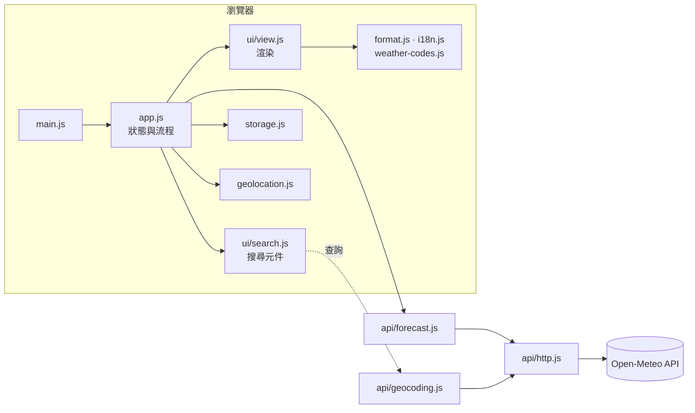

# 何妨吟嘯且徐行 · Time Weather

> 莫聽穿林打葉聲，何妨吟嘯且徐行。—— 蘇軾〈定風波〉

[](https://github.com/xdxd-lab/time_weather/actions/workflows/ci.yml)
[](https://xdxd-lab.github.io/time_weather/)


即時時鐘與天氣的網頁應用程式：目前天氣、未來 24 小時與 7 日預報、城市搜尋與定位。**打開瀏覽器即可使用，不需要下載或安裝。**

### ▶ 立即使用：<https://xdxd-lab.github.io/time_weather/>


---

## 目錄

- [功能](#功能)
- [技術特色](#技術特色)
- [快速開始](#快速開始)
- [專案結構](#專案結構)
- [架構](#架構)
- [設定](#設定)
- [部署](#部署)
- [商業使用須知](#商業使用須知)
- [已知限制](#已知限制)
- [瀏覽器支援](#瀏覽器支援)
- [路線圖](#路線圖)
- [參與開發](#參與開發)
- [資料來源與致謝](#資料來源與致謝)
- [授權](#授權)

## 功能

| 功能 | 說明 |
| --- | --- |
| 即時時鐘 | 每秒對齊整秒更新，不會漂移。選擇其他時區的城市時，自動切換為「當地時間」並顯示 UTC 偏移（會跟著夏令時間調整）。 |
| 目前天氣 | 溫度、今日高低溫、體感溫度、相對濕度、風速與風向、降水量、紫外線指數（含等級）、海平面氣壓、日出日落。 |
| 24 小時預報 | 逐時溫度、天氣圖示與降雨機率，可左右捲動。 |
| 7 日預報 | 每日天氣、降雨機率與高低溫區間條，一眼比較一週溫度變化。 |
| 城市搜尋 | 中英文地名皆可，支援注音／拼音輸入法、↑↓ 選擇、Enter 確認、Esc 關閉清單（再按一次清除輸入）。 |
| 定位 | 使用裝置位置；拒絕授權、逾時或不支援時，自動改用台北並在狀態列說明原因。 |
| 單位切換 | °C（km/h、mm）與 °F（mph、inch）一鍵切換。 |
| 記住偏好 | 記住溫度單位與最後搜尋的城市（按「使用目前位置」會改回定位並清除）；**不會**儲存裝置的位置。 |
| 自動更新 | 分頁開著時資料超過 15 分鐘即更新（約每分鐘檢查一次）；切回分頁且資料超過 10 分鐘、或恢復網路時也會更新。 |
| 情境背景 | 依天氣（晴、雲、霧、雨、雪、雷雨）與當地日夜變換背景與配色。 |

## 技術特色

- **無建置步驟、零執行期相依**：原生 ES modules，GitHub Pages 直接提供原始檔；開發工具只用於檢查與測試。
- **型別安全**：以 JSDoc 標註型別，CI 以 TypeScript `checkJs` + `strict` 檢查 `src/` 全部原始碼。
- **可靠的資料層**：每個請求都有逾時與取消機制；切換城市時會取消過期請求，舊回應不會覆蓋新資料；錯誤分為逾時、網路、HTTP、資料格式四類，並轉成可行動的中文訊息；API 回應先驗證再使用。
- **安全**：嚴格的 Content Security Policy（禁止行內腳本與樣式，只允許連到 Open-Meteo）；所有 API 與使用者資料都以 `textContent` 寫入，不經過 `innerHTML`。
- **隱私**：送出的座標四捨五入到約 1 公里；不儲存裝置位置；沒有 Cookie、分析或追蹤程式。
- **無障礙**：WAI-ARIA combobox 搜尋、狀態列 live region、跳到主要內容連結、清楚的鍵盤焦點、支援減少動態效果與 Windows 高對比模式。
- **測試**：Node 內建測試框架，涵蓋 API 解析、格式化、時區、儲存、定位，以及 HTML 與程式碼之間的契約測試；不碰 DOM 的模組有覆蓋率門檻。另以 Playwright 在 CI 的 Chromium 執行端對端測試，涵蓋定位備援、城市搜尋（滑鼠與鍵盤）、單位切換、錯誤訊息、手機寬度版面與 CSP；API 回應全部以測試資料模擬，不連外部網路。

## 快速開始

### 需求

- Node.js 22.13 以上（建議使用 [`.nvmrc`](.nvmrc) 指定的 24 LTS）

### 安裝與執行

```bash
git clone https://github.com/xdxd-lab/time_weather.git
cd time_weather
npm ci
npm run dev
```

開啟 <http://127.0.0.1:4173/time_weather/>。開發伺服器刻意使用與 GitHub Pages 相同的子路徑，絕對路徑寫錯會在本機就發現。

> 沒有安裝 Node.js？在專案的**上一層**目錄執行 `python3 -m http.server 8000`，再開啟 <http://localhost:8000/time_weather/>。
> 請勿直接用 `file://` 開啟 `index.html`：瀏覽器不允許從本機檔案載入 ES modules。

### 常用指令

| 指令 | 用途 |
| --- | --- |
| `npm run dev` | 啟動本機開發伺服器（預設埠 4173，可用 `-- --port 8080` 或環境變數 `PORT` 變更） |
| `npm run check` | 一次執行 lint、格式、型別與單元測試（送 PR 前請執行） |
| `npm run lint` | ESLint 靜態檢查 |
| `npm run format` / `format:check` | Prettier 自動排版／只檢查 |
| `npm run typecheck` | TypeScript 型別檢查（不輸出檔案） |
| `npm test` | 單元測試 |
| `npm run test:coverage` | 單元測試並檢查覆蓋率門檻（行 95%、分支 85%、函式 90%） |
| `npm run test:e2e` | Playwright 端對端測試（Chromium；初次需先執行 `npx playwright install chromium`，CI 會自動執行） |

## 專案結構

主要檔案如下（設定檔如 `.editorconfig`、`.nvmrc`、`.prettierrc.json` 未全部列出）：

```text
time_weather/
├── index.html              # 頁面骨架、CSP、SEO 與社群分享資訊
├── manifest.webmanifest    # Web App Manifest（名稱、圖示、主題色）
├── assets/
│   ├── css/app.css         # 設計 token、主題、版面與元件樣式
│   └── icons/icon.svg      # App 圖示／favicon
├── src/
│   ├── main.js             # 進入點
│   ├── app.js              # 控制器：狀態、流程、自動更新
│   ├── config.js           # 環境設定（API 位址、時間間隔、預設地點）
│   ├── api/
│   │   ├── http.js         # fetch 包裝：逾時、取消、錯誤分類
│   │   ├── validate.js     # 回應資料的執行期驗證
│   │   ├── forecast.js     # Open-Meteo 預報 API
│   │   └── geocoding.js    # Open-Meteo 地名搜尋 API
│   ├── ui/
│   │   ├── view.js         # 畫面渲染（不含狀態）
│   │   ├── search.js       # 無障礙城市搜尋元件
│   │   ├── icons.js        # 內嵌 SVG 天氣圖示
│   │   └── dom.js          # DOM 工具函式
│   ├── format.js           # 數字、時間、時區格式化（純函式）
│   ├── weather-codes.js    # WMO 天氣代碼對照
│   ├── i18n.js             # 所有介面文字
│   ├── errors.js           # 錯誤 → 使用者訊息
│   ├── storage.js          # 偏好設定儲存
│   ├── geolocation.js      # 定位 API 包裝
│   └── types.js            # 共用 JSDoc 型別
├── tests/                  # node:test 單元與契約測試
├── e2e/                    # Playwright 端對端測試
├── scripts/serve.mjs       # 零相依開發伺服器
├── docs/images/            # 文件用截圖
├── package.json            # 開發指令與開發工具版本
├── eslint.config.js        # ESLint 規則
├── playwright.config.js    # 端對端測試設定
├── tsconfig.json           # 型別檢查設定
├── CONTRIBUTING.md · CHANGELOG.md · SECURITY.md
└── .github/                # CI、Dependabot、PR／Issue 範本
```

## 架構

資料單向流動：**事件 → 控制器更新狀態 → 畫面渲染**。可測試的邏輯都放在不碰 DOM 的模組，因此能在 Node 中直接測試。



幾個關鍵設計：

- **時間不做時區換算**：API 以 `timezone=auto` 回傳地點當地的時間字串，逐時預報直接以字串比較找出「現在」，避免裝置時區與地點時區不同時出錯。
- **請求競態**：每次載入都會取消前一個請求，並在回應抵達時確認仍是最新請求。
- **失敗時保留舊資料**：更新失敗時繼續顯示上一次成功的資料，並在狀態列標示資料時間；切換城市則一定清空，避免顯示錯誤地點的天氣。

## 設定

所有環境相關設定集中在 [`src/config.js`](src/config.js)：

| 設定 | 預設值 | 說明 |
| --- | --- | --- |
| `forecastUrl` | Open-Meteo 免費端點 | 預報 API 位址；商業部署改為自己的代理伺服器 |
| `geocodingUrl` | Open-Meteo 免費端點 | 地名搜尋 API 位址 |
| `requestTimeoutMs` | 10 秒 | 單一請求逾時 |
| `refreshIntervalMs` | 15 分鐘 | 背景自動更新間隔 |
| `staleAfterMs` | 10 分鐘 | 切回分頁時，資料超過此時間就更新 |
| `forecastDays` / `hourlySlots` | 7 / 24 | 預報天數與逐時筆數 |
| `defaultPlace` | 台北 | 無法定位時的預設地點 |
| `locale` | `zh-TW` | 日期、時間的顯示語系 |
| `geocodingLanguage` | `zh` | 地名搜尋結果的語言 |
| `geolocationTimeoutMs` | 8 秒 | 等待裝置定位的時間 |
| `geolocationMaxAgeMs` | 10 分鐘 | 可沿用的快取定位時間 |
| `searchDebounceMs` | 300 毫秒 | 停止輸入多久後才搜尋 |
| `searchResultLimit` | 6 | 搜尋結果最多筆數 |

更改 API 位址時，請一併更新 `index.html` 中 CSP 的 `connect-src`；`tests/markup.test.js` 會檢查兩者是否一致。

## 部署

目前以 **GitHub Pages** 從 `main` 分支根目錄部署，合併後約 1 分鐘生效。`.nojekyll` 讓 Pages 原樣提供檔案。

本專案是純靜態檔案，也可放在任何靜態主機或 CDN。若主機可設定 HTTP 標頭，建議改用標頭提供 CSP，並加上 meta 標籤做不到的 `frame-ancestors 'none'`、`Strict-Transport-Security` 與 `X-Content-Type-Options: nosniff`。

## 商業使用須知

> [!WARNING]
> **目前使用的 Open-Meteo 免費 API 僅限非商業用途。** 依 [Open-Meteo 使用條款](https://open-meteo.com/en/terms)，含訂閱或廣告的網站或 App 屬於商業用途。

正式商業化前請完成：

1. **購買 Open-Meteo API 方案**（Standard 以上），取得 API key。商業端點為 `customer-api.open-meteo.com`，請求格式相同，只需加上 `apikey` 參數。
2. **不要把 API key 放進前端**：靜態網站的程式碼任何人都看得到。請建立伺服器端代理（例如 Cloudflare Workers、Vercel Functions）代為加上 key，再把 `config.js` 的 `forecastUrl`／`geocodingUrl` 與 CSP 指向代理。
3. **保留資料來源標示**：天氣資料採 [CC BY 4.0](https://creativecommons.org/licenses/by/4.0/) 授權，必須在顯示資料的頁面附上 Open-Meteo 連結；地名資料需標示 GeoNames。頁尾已內建，修改版面時請保留。
4. **注意用量上限**：免費方案每日 10,000、每小時 5,000、每分鐘 600 次請求。單次預報請求超過 10 個變數，依官方計算方式約計為 2 次。
5. **選定授權條款**：見下方〈授權〉。

## 已知限制

- **中文地名**：地名資料來自 GeoNames，中文名稱簡繁混雜，部分台灣城市用中文搜尋不到。用英文搜尋最可靠，例如 `Taipei`、`Kaohsiung`、`Taichung`。
- **定位地點名稱**：Open-Meteo 不提供反向地理編碼，使用裝置定位時顯示為「目前位置」。
- **資料性質**：預報來自數值天氣模式，並非官方氣象機關發布。在台灣，災害性天氣請以[中央氣象署](https://www.cwa.gov.tw/)為準。

## 瀏覽器支援

支援近年的主流瀏覽器：Chrome／Edge 98+、Firefox 94+、Safari 15.4+（含 iOS／iPadOS）。最低版本主要取決於 `Object.hasOwn`、`Intl` 時區偏移格式與 CSS `dvh`（舊版會退回 `vh`）。

## 路線圖

- [ ] 空氣品質指標（Open-Meteo Air Quality API）
- [ ] 收藏多個城市並快速切換
- [ ] 英文介面（文字已集中在 `src/i18n.js`）
- [x] 以 Playwright 在 CI 執行端對端測試
- [ ] 視覺回歸測試（截圖比對）
- [ ] 評估離線殼層（Service Worker）與其快取更新策略

## 參與開發

歡迎提出 Issue 與 Pull Request。開發流程、程式風格與發布步驟請見 [CONTRIBUTING.md](CONTRIBUTING.md)，版本紀錄見 [CHANGELOG.md](CHANGELOG.md)，安全性問題回報方式見 [SECURITY.md](SECURITY.md)。

## 資料來源與致謝

- 天氣資料：[Open-Meteo.com](https://open-meteo.com/)，[CC BY 4.0](https://creativecommons.org/licenses/by/4.0/)
- 地名資料：[GeoNames](https://www.geonames.org/)，[CC BY 4.0](https://creativecommons.org/licenses/by/4.0/)
- 專案名稱出自蘇軾〈定風波·莫聽穿林打葉聲〉

## 授權

本專案**尚未指定開放原始碼授權條款**，因此依著作權法保留所有權利：他人可以瀏覽程式碼，但未經許可不得重製、修改或散布。若要開放他人使用或進行商業合作，請先選定授權條款（例如 MIT、Apache-2.0 或專有授權）並新增 `LICENSE` 檔案。
