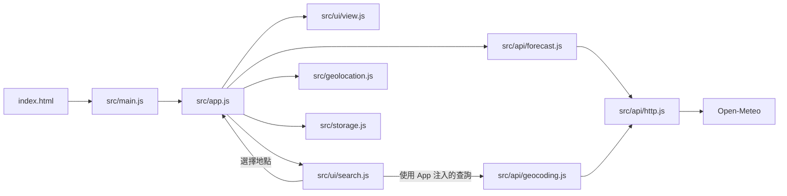

# 架構與部署

[返回 README](../README.md) · [驗證與效能量測](verification.md)

## 資料怎麼流動

頁面載入 `src/main.js`，再由 `App` 建立控制器，綁定介面事件、啟動時鐘與預報更新。搜尋、定位和刷新只改變 App 所持有的應用程式狀態；畫面由 `WeatherView` 渲染，搜尋元件只管理自己的輸入、清單與焦點。

| 邊界 | 要保護的行為 |
| --- | --- |
| 外部資料進 App | 請求逾時、可中止；驗證 JSON 形狀後才轉成預報或地點資料。請求取消不應顯示為網路錯誤。 |
| 非同步工作交錯 | 開始新的預報請求會取消上一個，回應抵達後還會核對請求身分。定位等待時選了城市，舊定位結果不得覆蓋新選擇。 |
| 資料過期或請求失敗 | 同地點刷新失敗保留最後一筆成功預報，並顯示更新時間；切換地點先清空舊資料，避免地名與天氣錯配。 |
| 當地時間 | API 以地點時區回傳當地時間。逐時預報按地點的時間字串篩選，不把不帶偏移的時間字串當成使用者裝置時區。時鐘另以 `Intl` 格式化。 |
| 輸出與儲存 | API 文字以安全 DOM API 寫入。儲存時只允許搜尋地點與單位，讀回時重新驗證；定位座標不寫入瀏覽器儲存。 |

## 設定在哪裡

[`src/config.js`](../src/config.js) 集中管理 API 主機、逾時、定位快取、刷新門檻、預報長度、搜尋限制及預設地點。畫面文字在 [`src/i18n.js`](../src/i18n.js)，天氣分類在 [`src/weather-codes.js`](../src/weather-codes.js)。

更換 API 位址時，要一併更新 [`index.html`](../index.html) 的 CSP `connect-src` 並執行 [HTML 契約測試](../tests/markup.test.js)。預報傳出的座標會四捨五入，搜尋會傳送使用者輸入的查詢文字。不要新增原始座標、完整位置資料或金鑰到日誌、測試追蹤或任何新的持久儲存。

商業部署需另確認 [Open-Meteo 使用條款](https://open-meteo.com/en/terms)。需要 API 金鑰時，讓服務端代理加上金鑰，把前端端點及 CSP 改指代理，保留 Open-Meteo／GeoNames 的來源標示。不把金鑰加到任何瀏覽器可讀的檔案。

## 靜態部署

GitHub Pages 提供 `main` 根目錄的靜態檔案，`.nojekyll` 讓檔案按原樣發佈。沒有打包或轉譯步驟；保持 `/time_weather/` 子路徑相容，不在頁面用從網域根目錄開始的內部資產 URL。網站必須透過 HTTPS 或受支援的本機安全來源才能測試地理定位。

若部署到可以控制 HTTP 標頭的靜態主機，可用標頭設定 CSP 和頁面框架限制，並按主機政策加入 HSTS 與 `X-Content-Type-Options: nosniff`。確認所設標頭不會改變本機允許的對外連線或使原生 ES modules 載入失敗。
